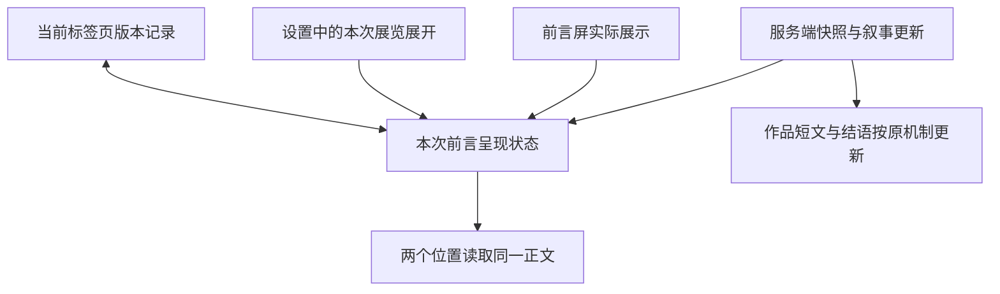

# Claude Opus 报告复核与修改计划

本文先于 2026-10-29 完成报告复核与修改提案。用户随后明确批准执行五项计划，并要求 commit、push 和腾讯服务器公网同步；实施沿用当前分支，由主线程完成。该批准不包含新增 agent、分支或 worktree。

代码基准：`28894783c6f40764d25b53252b738137f9f51aac`。复核来源为当前源码、此前 Claude Code `claude-opus-5-5` 原始报告、同版本的浏览器记录和截图，以及已确认的产品决定。原报告保持原样。

## 1. 复核结论

报告找到了真实的连续性问题，但将部分设计取舍写成了实现缺陷，若照单执行，会重新打开已经确认的产品设计。

**本轮最优先的是设置返回。** 浏览器 Back 越过面板离开展览，与阅读、近看的行为不一致。前言版本、动作命名和入口保留原句也值得修正。现有首页、玻璃操作、纸质阅读、静观淡出和自主换画已形成连贯方向，应在此基础上修整。

原报告的 `Block` 是它自己的评审等级。我认可设置返回需要优先修复，但不据此断言已经发生不可恢复的数据丢失、真实手机手势故障或整个产品无法使用，也不把十项建议全部升格为阻断项。

| 原编号 | 我的判断 | 核对结果与处理 |
| --- | --- | --- |
| #1 设置 Back | **成立，高优先级** | `walk.tsx` 仅管理原生 dialog；`back-settings.json` 记录第一次 Back 从展厅回到入口。阅读与近看已经使用共享历史控制器。雕塑设置和手写面板有相同接线缺口，但尚无本轮操作实证。纳入 U1。 |
| #2 资料页多一次讲解点击 | **不成立为必改缺陷** | 独立资料页和主动生成讲解是已确认设计。资料页提供馆藏说明、作者、时期、部门、媒材等内容，不能将其概括为只有一个讲解按钮；部分内容重复可以讨论，但不能由此要求自动生成。卸载时释放环境音属实，也符合既有“退出停止”边界；跨页声音连续性另需产品决定及实测。保留当前路径。 |
| #3 侧厅两个按钮同向 | **现象成立，缺陷结论不成立** | `continueAfterEncounter` 确实结束偶遇并进入原路线下一件，符合已确认的略过／继续契约。侧厅没有直接回锚点按钮，但继续后仍可上一件，不能写成完全回不去。新增侧厅后退属于产品方案，未纳入本轮。 |
| #4 回退文案与两版前言 | **成立，分成两个问题处理** | 截图 04/08 确认同次展览先后显示不同前言；源码分别是组件本地冻结和直接读取实时快照。回退选择整句也确实会带出审核用语。纳入 U2/U3；不采纳“删除所有否定／不确定词”的泛化修法。 |
| #5 静默按钮不易发现 | **有依据的体验假设，未证实操作失败** | 截图中的结语动作和顺序选择缺少常驻边界，CSS 也确认 quiet 样式依赖交互态；但祈使文案、位置与分组仍提供操作线索，不能仅凭截图证明用户找不到。保留为针对首次触屏使用的观察项，不统一加底色或下划线。 |
| #6 可见文字与辅助名称不一致 | **成立，中优先级** | “进入展厅／跳过前言”“看完了／进入结语”“返回画作或雕塑／收起完整展签”均可由源码确认；展签按钮名称还覆盖了作品标题。近看触发器的“进入画中／进入沉浸体验”也应一起核对。纳入 U4；不声称具体语音软件已实测失败。 |
| #7 换画节奏承诺 | **文案问题成立，删除功能的建议不采纳** | 实际效果是过渡时长微调及慢节奏时的浮尘收敛，换画仍由用户操作。记录和轻量节奏适配已有明确方案；开关也不是采集授权，关闭它不会停止记录。U4 纠正文案，不删除既有行为。 |
| #8 术语与品牌入口 | **部分成立，需缩小验收范围** | “件／幅”“展厅／画廊”在同一操作中切换值得统一。前言、结语以及资料页的品牌链接确实没有携带 query；展厅与正式侧厅有。文字链接 ArtDuo 本身已有可访问名称，缺少 aria-label 不等于无名称。U4 修导航语义与原句保留，不做全文禁词。 |
| #9 结语图片与图注分离 | **成立，低优先级** | 桌面截图 14 显示横幅末件下方的大块空白；固定高图片框加 contain 使图注跟着框底走，而非图像下沿。纳入 U5，同时检查手机、竖幅和失败态。 |
| #10 英文 alt 后缀 | **低优先级润色成立** | `artwork`、`artwork immersive view` 是界面模板用语，可以中文化。原始外文作品标题应保留；混合语言本身不能证明读屏不可用。并入 U4。 |

辅助名称包含可见标签是 [W3C WCAG 2.5.3 的要求](https://www.w3.org/WAI/WCAG22/Understanding/label-in-name.html)。有可见文字时优先使用原生名称，补充用途可以放在描述中，不必为每个按钮再写一份不同的名称。

### 报告中需要纠正的验收口径

- “再 Back 一次才离开展览”应理解为回到该页面原来的历史前项；直达展厅并不保证历史前项是 ArtDuo 首页。
- 不确定性如果与用户明确要求有关，例如所问的手部细节无法确认，必须继续说明；不能为了文风把未知改成肯定。
- 导航用“件／展厅”，不代表作品正文中不能出现“一幅画”，也不要求改写旧版页面或馆藏原文。
- 模拟手机尺寸与浏览器历史操作不能代表实体 iPhone / Android 手势验收；静态截图不能证明动效、声音或性能。

## 2. 本轮目标与边界

| 目标 | 验收结果 | 对应单元 |
| --- | --- | --- |
| R1 临时操作可预期地返回 | Back、关闭、Escape 各消费一次临时层；作品、路线、会话不变 | U1 |
| R2 回退叙事适合阅读且依据可靠 | 使用有依据的完整画面关系；必要的信息缺口仍准确表达 | U2 |
| R3 本次读到的前言保持一致 | 前言屏与设置使用同一正文；会话存储可用时，资料页返回与刷新也恢复该版本 | U3 |
| R4 动作、名称和导航一致 | 可见与辅助名称吻合；同一动作使用同一术语；返回入口保留原句 | U4 |
| R5 结语形成完整视觉收束 | 图注紧随实际显示图像，横竖幅及窄屏均成立 | U5 |

范围为当前 `apps/web` 与 `packages/ui` 的正式体验，以及 U2 使用的 API 叙事服务。基础方案承接 [2026-10-28 综合结论](../reviews/artduo-frontend-consolidated-review-2026-10-28.md)、[观看恢复方案](2026-10-28-viewing-recovery.md)、[观看反馈方案](artduo-viewing-adaptation-2026-10-09.md) 和 [雕塑偶遇方案](artduo-sculpture-encounters-2026-10-27.md)。旧资料中被后续决定覆盖的内容不重新启用。

本轮不设计自动讲解、侧厅后退路线、跨页持续播放、全局玻璃重绘或新的观看记录机制。#5 属于待验证的设计建议；#2/#3 的替代交互属于未采纳建议，不记作已修复问题或用户同意延期的必需项。

## 3. 模块与关键决策

### 临时层归属

继续由 `overlay-history.ts` 管理浏览器临时记录，`use-overlay-history.ts` 对接组件。原生 dialog 保留焦点约束和 Escape 事件；各组件只负责自己的打开状态、暂停状态与焦点恢复。无需为设置增加 URL phase，也不为每件作品堆积历史。

| 事件 | 所需行为 |
| --- | --- |
| 打开设置／手写面板 | 注册一个临时层，保持当前 URL 的展览位置 |
| 浏览器 Back | 收起当前层；正常退层时恢复触发器焦点 |
| 点击关闭、遮罩或 Escape | 经同一关闭路径消费临时记录，避免又关闭又额外后退 |
| 已关闭后 Forward、打开时刷新 | 沿现有策略消除失效层，不重新弹开面板或形成空历史循环 |
| 真正跨页离开 | 清理当前层，不把用户拉回旧页面，不把焦点送回已卸载节点 |
| 手写制作期间关闭面板 | 仅收起 UI，保持现有任务、草稿与显式取消语义 |

设置内的 details 展开、复选框改变和手写表单内部状态，不各自创建历史记录。共享控制器仍管理单个活动临时层，不新建一套叠层路由系统。

### 前言数据归属

服务器快照继续接收新的叙事片段；UI 单独保存“本次已呈现的前言”。两者具有不同职责，不能冻结整份快照或停止后续作品短文的更新。

以下示意用于说明方案边界，不是待复制的实现代码。

- 控制器放在 UI 体验层，生命周期覆盖 `Preface` 与 `Walk`；按 release、recipe 与 curation / exhibition 身份区分，不按当前作品或重排后的顺序另开版本。
- 只在前言正文即将实际显示时锁定。设置未展开、前言仍是占位或用户直接跳过时，不提前把后台候选文本锁死。
- 延续当前前言最多三秒等待规则：有可用正式片段可提前显示，超时或请求已结束使用回退。已经显示的正文不因迟到片段替换。该等待不阻塞“进入展厅”。
- 使用独立、带版本且有大小限制的 sessionStorage 记录保存已呈现前言；不塞入 URL、服务端策展记录或观看行为统计。仅记身份与呈现所需文本／来源，不复制整份快照。
- 客户端恢复完成前使用既有占位，不先显示一版服务器正文再闪换为已保存版本。存储不可用时使用有界内存回退，保证当前文档生命周期内一致；原生链接导航、刷新等重新加载文档的情形无法依赖模块内存恢复。当前资料页返回使用原生链接，因此该降级不能写成跨页恢复也已保证。
- 新策展／新 release 不复用旧文本；返回同一展览可以恢复。重新进入入口本身不偷偷清除其他观展状态。
- 本次只锁定前言。结语、分享和手写仍由原有内容身份与任务流程管理，避免将早期前言修复扩展成全展览冻结。

上述跨组件、跨重挂载的呈现记录已随本计划获得执行批准；不能把组件本地 ref 当成已经满足这些边界。

### 回退与缓存

回退短文从已有可确认观察中选择完整语句或子句，保留 source 与 evidenceIds。筛选针对展示用语，不改 `visualObservation`、结构化事实或事实校验器；未知仍是未知。用户明确请求的细节缺口继续用面向观众的说明表达。

`readNarrativeCache` 已会依据当前事实重新生成缓存中的 fallback 文案。因此这次展示选择修正不需要清空已生成的正式文案缓存、改变策展身份或提高模型调用量；以缓存回归确认该约束，不默认升级通用叙事 recipe。

## 4. 实施单元

建议按 U1 → U2 → U3 → U4 → U5 顺序执行。U2/U3 需要合并验收“延迟或失败时显示什么、随后是否一致”；其余单元可分别验证。这个顺序不包含 agent 并行或分支安排。

### U1 · 补齐设置与手写面板的返回契约

- [x] 实施并完成 R1 验收。

**涉及文件**

- 修改：`packages/ui/src/experience/walk.tsx`、`packages/ui/src/experience/sculpture-room.tsx`、`packages/ui/src/experience/handwritten-keepsake.tsx`。
- 复用：`packages/ui/src/experience/use-overlay-history.ts`、`packages/ui/src/experience/overlay-history.ts`；只有发现实际缺口时才改共享实现。
- 现有回归：`packages/ui/src/experience/overlay-history.test.ts`、`packages/ui/src/experience/state.test.ts`、`packages/ui/src/experience/sculpture-encounter.test.ts`、`packages/ui/src/immersive/image-lightbox.test.tsx`。
- 浏览器接线验收记录：拟新增 `docs/verification/artduo-experience-continuity-2026-10-29.md`。

**方法与接口**：三个面板注册到已有临时层控制器，所有关闭入口统一经过返回路径。根据是否仍在同一视图恢复焦点，按组件生命周期解除阅读／暂停状态。保持手写生成、确认和取消接口不变。

**验证场景**

1. 从入口进入任一绘画，打开设置再 Back：面板关闭，query、release、curationId、artworkId、route 与作品可见内容都不变；焦点返回设置入口。下一次 Back 才按原历史离开。
2. 通过确定性 fixture 进入正式侧厅，在设置中 Back：仍在同一件雕塑，偶遇继续为 active，未发生继续、重抽或绘画索引前进。独立试展页另测同一面板。
3. 在前言、结语分别打开手写面板；Back、Escape、关闭按钮及面板内“继续观展／返回结语”只收起一次。模拟进行中的任务保持同一 job、草稿与确认状态，再打开不重复创建任务。使用受控 provider，不为验收实际提交收费制作。
4. 快速开关、连续 Back、Forward、面板打开时刷新、从深链进入：无残留锁定、错误焦点、重复历史与回弹。
5. 阅读／近看原有 Back、近看换画失败后恢复、资料页跳转仍通过。共享历史纯逻辑已覆盖的用例直接复用，新增重点是三个真实面板的接线，避免重复测试相同实现。

**完成依据**：真实浏览器行为记录和相关既有测试均通过；只看调用了 hook 不算验收。

### U2 · 将回退叙事转为可信的观展文案

- [x] 实施并完成 R2 验收。

**涉及文件**

- 修改：`apps/api/src/services/curation/exhibition-narrative.ts`。
- 测试：`apps/api/test/services/exhibition-narrative.test.ts`、`apps/web/test/lib/exhibition-narrative-server.test.ts`。
- 核对集成：`apps/web/lib/exhibition-narrative-server.ts`。

**方法与接口**：保留现有叙事片段协议，先挑选有依据且适合直接阅读的完整画面关系；核查范围、辨认过程等措辞不混入导语。没有可用画面关系时，退到已知媒材、年代或简洁资料状态。不得从用户愿望反推画面里有清晨、河岸或树影，也不为了优美新增模型请求。

不能仅复用报告提到的正则便认为完成：`validateGroundedClaims` 中那段逻辑用于事实校验中的不确定性识别，不等于完整的导语选句规则。不得只删“未见”或“无法确认”等前缀后保留其后的肯定命题。

**验证场景**

1. 以“赭黄屋顶／蓝色海湾＋当前预览未见人物＋不足以确认是否为船”构造 fixture：导语保留被支持的画面关系，不出现审核流程措辞，也不声称有船、无人或河岸。
2. 确认主体与不确定主体混在同句、只有不确定观察、完全没有观察、只有日期／媒材：输出完整、非空、不截断词句，不编造缺失事实。
3. 用户明确要求手部／道路但证据不足：仍说明无法确认；有相关证据时保留已验证的观看焦点。不用全局禁词断言误杀必要告知。
4. 无作品、少于期望数量、只要观察不需情绪引导、中英文标点和长标题：保留当前真实数量、语气边界及 evidenceIds。
5. 模型中断、部分成功、缓存回退：旧 fallback 使用新的选句；已通过验证的 grounded 片段保留，重试冷却和请求次数不因 UI 修正改变。

**完成依据**：真实问题样本文案可读，现有事实、来源、顺序和缓存约束全部通过。预期语气改善不能代替事实断言。

### U3 · 将已展示前言提升为本次观展的共享状态

- [x] 实施并完成 R3 验收。

**依赖**：U2 的展示文案策略确认；可单独实现，但共同验收。

**涉及文件**

- 新增：`packages/ui/src/experience/presented-preface.ts`、`packages/ui/src/experience/use-presented-preface.ts`，分别承载状态／存储校验与 React 生命周期。
- 修改：`packages/ui/src/experience/experience-shell.tsx`、`packages/ui/src/experience/preface.tsx`、`packages/ui/src/experience/walk.tsx`。
- 复用／核对：`packages/ui/src/experience/use-stable-narrative.ts`、`apps/web/components/experience-route-client.tsx`、`apps/web/components/use-curation-narrative.ts`；不复制网络订阅。
- 新增测试：`packages/ui/src/experience/presented-preface.test.ts`。
- 浏览器集成：同 U1 的验收记录。

**方法与接口**：呈现控制器接收展览身份、最新候选、pending 状态及是否有展示面；输出共享的待定／已呈现前言。`Preface` 与 `Walk` 读取同一结果；Walk 只在“本次展览”展开时请求展示。旧本地冻结逻辑按需适配前言，不改变 Closing 和已打开阅读正文的策略。

**验证场景**

1. 正式片段在等待期限前到达：两个位置使用该片段；回退先被读到而正式片段迟到：两个位置继续使用回退。用受控时间测试先后顺序，不依赖真实网络竞速。
2. 用户在正文出现前进入展厅：不因离开前言就锁定未见版本；首次展开“本次展览”才形成已呈现版本。
3. 展厅深链直达、设置一直未打开、同一展览重排或前后换画：无无意义的提前冻结或额外叙事请求。
4. 会话存储可用时，资料页原生链接往返、浏览器 Back / Forward、刷新：同一身份恢复正文；换 release 或策展身份不串文案。
5. 存储拒绝、JSON 损坏、身份不符、超长文本、未知来源：拒绝无效记录并保持观看可用；SSR 到客户端恢复不先显示错误版本再替换。存储被禁且文档重载时，按新一次呈现选文案并重新保证两个位置一致，不声称恢复了重载前的版本。
6. 已锁定前言后，其余作品短文仍能更新，结语／分享／手写的原内容身份机制仍正常；不能靠冻结整个 snapshot 通过测试。

**完成依据**：在受控延迟、失败和跨页恢复路径下，前言屏与设置正文逐字一致；记录生命周期和降级限制有明确证据。

### U4 · 统一动作、辅助名称与返回入口

- [x] 实施并完成 R4 验收。

**涉及文件**

- 修改：`packages/ui/src/experience/preface.tsx`、`packages/ui/src/experience/room.tsx`、`packages/ui/src/experience/plaque.tsx`、`packages/ui/src/experience/viewing-controls.tsx`、`packages/ui/src/experience/experience-shell.tsx`、`packages/ui/src/experience/sculpture-room.tsx`。
- 修改：`packages/ui/src/immersive/image-lightbox.tsx`、`packages/ui/src/immersive/immersive-detail-stage.tsx`、`apps/web/app/artwork/[id]/page.tsx`。
- 复用：`apps/web/lib/experience-navigation.ts` 与已有 `restartHref`；UI 包不反向依赖 web 包。
- 测试：`packages/ui/src/experience/plaque.test.tsx`、`packages/ui/src/immersive/image-lightbox.test.tsx`、`apps/web/test/lib/experience-navigation.test.ts`，新增 `packages/ui/src/experience/experience-navigation-labels.test.tsx` 检查实际组件输出的入口与动作名称。
- 同步受影响的既有 E2E 定位，尤其 `apps/web/e2e/experience-flow.spec.ts`、`apps/web/e2e/experience-states.spec.ts`；不得继续把旧 aria-label 当成产品契约。

**建议文案与行为**

| 场景 | 建议 |
| --- | --- |
| 前言主动作 | 可见及辅助名称均以“进入展厅”为准 |
| 末件完成 | 可见“看完了”，必要的辅助描述补充“进入结语” |
| 阅读退出 | 按对象使用“返回画作／返回雕塑”，辅助名称保留同样文字 |
| 展签展开 | 名称保留作品标题；打开中仍可识别当前作品和取消动作 |
| 近看 | 保留当前“放大／进入画中”的可见提示，辅助名称包含该提示与作品名；返回称“返回展厅”，导航称“上一件／下一件” |
| 品牌入口 | 统一表达“ArtDuo，返回入口”；在已有展览上下文的页面保留原句。首页和独立预览不人为补造 query |
| 过渡开关 | “按停留时间微调画面过渡”；必要的短说明明确换画由观众操作、记录仅在本标签页保存，避免暗示关闭开关就停止记录 |
| 图像 alt | 作品原名配适当中文上下文，移除模板式英文后缀 |

**验证场景**

1. 检查浏览器计算出的名称，而非只搜索 aria-label；覆盖普通态、打开中、雕塑阅读、动态手机感应按钮和近看提示。
2. 从前言、绘画展厅、正式侧厅、结语和资料页点击品牌入口：回到同一新版输入页，原句完整保留，不自动提交新策展。原句含中文、标点、`&` 等字符仍正确编码。
3. 资料页“返回刚才的位置”继续恢复原展览、顺序和作品；它与品牌“返回入口”各自表达准确目的。
4. 共享近看组件的其他当前调用方仍有正确名称。只改导航 UI 用词，不按全文 grep 改写正文或馆藏内容。
5. 过渡与记录逻辑保持既有行为，关闭微调／清除记录的说明与实际结果一致。

**完成依据**：动作映射表、组件输出、真实导航和可访问性树相符。这里的命名与目的地检查有用户行为意义；普通文字替换不另建镜像式测试。

### U5 · 让结语图注跟随图像实际边界

- [x] 实施并完成 R5 验收。

**涉及文件**：`packages/ui/src/experience/closing.tsx`、`packages/ui/src/experience/experience.css`；验收写入同一浏览器记录。

**方法**：让图像和图注成为同一个按真实比例排版的 figure；保留现有最大高度、完整显示及双列／单列关系。使用可用的尺寸信息预留比例；尺寸未知时在解码后确定布局，同时明确加载和失败占位，避免删除固定高度后引入跳动或空白巨框。

**验证场景**：1440×900、390×844、320px 下分别检查横幅、竖幅、方幅、极宽图、长标题、加载和失败。成功时图像可见下沿到图注首行的留白控制在约 16–24px，图注跟随图像左边界；全图不裁切，窄屏无横向溢出，结语正文和操作可达。测量的是 contain 后的实际图像内容边界，不能只量固定 img 元素框。

**测试要求**：纯布局修整不新增复制 CSS 数值的单元测试；以解码完成后的截图与实际边界核对。主流程仍回归主动结束、回看末件与分享失败恢复，不改变其触发时机。

## 5. 整体验收与风险

实施后运行相关单元测试、全项目类型检查和生产构建，再以 Ego 浏览器完成关键路径及上述故障／延迟场景。采用最近观看恢复方案的验收方式；保持适用的既有检查和已批准例外，不把本次规划当成测试豁免。默认不新增 Playwright 流程，不为满足工具偏好安装全局依赖。

| 风险 | 控制与证明 |
| --- | --- |
| 原生 dialog 和历史各自关闭，触发双重返回 | 统一关闭入口；真实 Back、Escape、快速重开与原有阅读／近看回归 |
| 面板关闭误取消制作或推进侧厅 | 使用受控任务／正式偶遇 fixture，逐项比较任务 ID、状态、锚点和路线 |
| 前言在错误生命周期锁定，或跨展览串用 | 只在真实展示时锁定；身份校验、版本化记录、有限缓存、延迟与恢复测试 |
| 改善文风却抹掉未知或改变事实 | 保留原始证据；区分审核用语和必要限制；对结构化 unknown 和用户关注点做反例测试 |
| 共享近看组件文案变动影响现有测试与调用方 | 同步定位与组件验收，保留当前调用语义；不全局替换自然语言 |
| 结语按比例排版后发生加载跳动 | 带尺寸和无尺寸样本分别测试；只在解码终态评价最终间距 |

验收记录至少保存 revision、fixture / 真实展览身份、环境与尺寸、Back 前后状态、延迟叙事的到达和呈现顺序、失败路径、截图和未验证项。手机尺寸模拟单列为模拟；真机 Safari / Android 手势、感应、软键盘、读屏与首次用户发现性需要各自证据。本轮不借已有 15 项测试通过关闭这些边界，也不重新认定首画性能已达标。

## 6. 本次规划的检查记录

- 重新核对了十项报告与当前源码，查看了桌面结语、手机结语、设置展开三张原图及设置 Back 记录；复用了前轮同版本证据，没有重新启动应用或运行测试。
- 前轮 15 项通过仅覆盖原有状态、临时层历史和近看渲染，不是本计划新增面板、呈现状态与布局的验收。
- 已读取知识图谱报告：图更新于 2026-05-13，未覆盖当前 experience 主线；本轮定位以现有源码及十月方案为准。仓库没有 `docs/solutions`，采用相关已落地方案与验证记录作为本地经验来源。
- 规划时由主线程按一致性、可执行性、范围、状态生命周期和验收完整性检查；没有追加独立 agent 评审。自检补清了存储不可用时原生链接重载无法依靠内存恢复的边界，并将概览与验收同步。规划完成时尚未实施；批准后的执行记录见下文。
- 后续用户批准覆盖本文五项修改范围与技术方案，以及 commit、push 和腾讯公网同步；#2/#3 的新交互和 #5 的视觉替代不在本次实施范围。

## 7. 批准后的执行记录

五项修改及本地验收均已落实。设置、手写、正式雕塑偶遇和独立试展接入共享临时层历史；回退选句保留事实边界；前言仅在实际展示时按身份保存；动作与入口命名统一；结语根据图片实际比例排版。结语验证还发现缓存图片在 hydration 前加载完成时遗漏就绪状态，已补原生完成状态观察与三项回归。

最终本地全套回归 547/547，通过桌面和 390 / 320px 浏览器尺寸的受控验证。应用提交 `6876ae1c2af11c2c52da2a9d7b018b44d6100fa3` 已推送，腾讯在 2026-10-30 00:20:53（北京时间）切换至 `20261029-experience-continuity`。目标机 163 项相关回归、构建、类型和素材检查均通过；两个公网域名的版本、交互、资源及邻站入口已核对。候选、隔离状态、临时包和助手脚本已清理，旧版本及完整备份保留。相关证据、实际限制与发布回执集中在[验收记录](../verification/artduo-experience-continuity-2026-10-29.md)。

## 参考

- 上轮交付：`claude-review.txt`、`review-notes.txt`、`back-settings.json`、截图 `04-preface-mobile.png` / `08-settings-expanded-mobile.png` / `13-closing-mobile.png` / `14-closing-desktop.png`。关键事实已在本文记录，原始报告未改写。
- [当前产品决定与既有评审裁定](../reviews/artduo-frontend-consolidated-review-2026-10-28.md)。
- [临时层与媒体恢复方案](2026-10-28-viewing-recovery.md)、[对应验证记录](../verification/artduo-viewing-recovery-2026-10-28.md)。
- [观看记录与节奏的既有边界](artduo-viewing-adaptation-2026-10-09.md)、[雕塑侧厅继续契约](artduo-sculpture-encounters-2026-10-27.md)。
- [W3C：Label in Name](https://www.w3.org/WAI/WCAG22/Understanding/label-in-name.html)。
